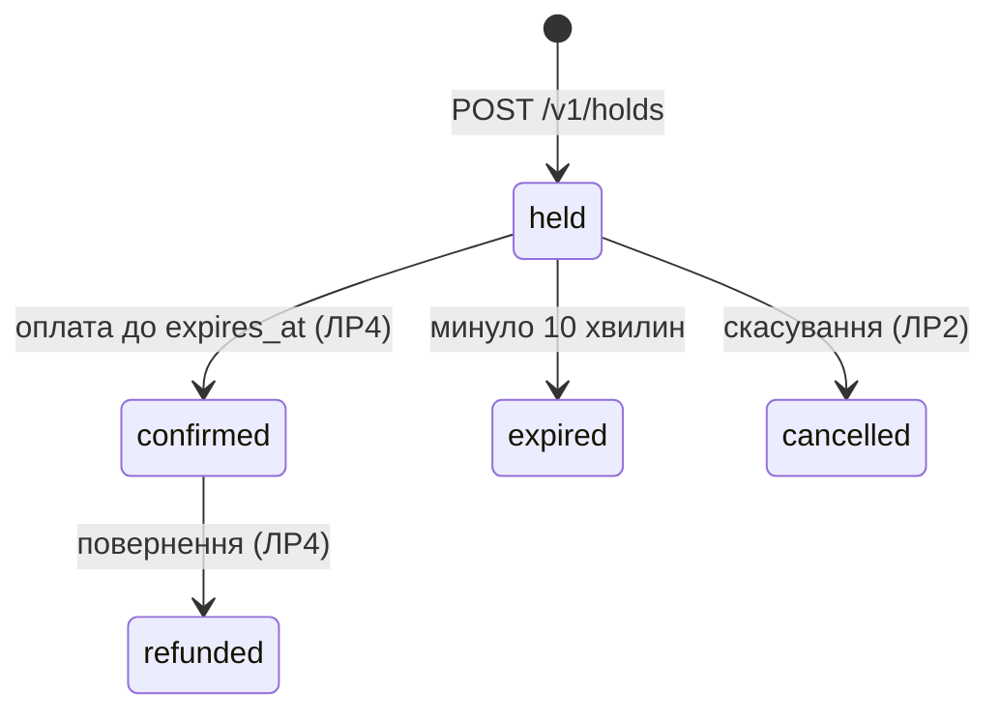

# Web ЛР1: модель, контракт і перша операція

Стан на 2026-11-25. Виконавець — учасник 1. Опис реалізованого й перевіреного; результати запусків —
[results/web-lr1.md](../../results/web-lr1.md), маршрути — [web/openapi.yaml](../../web/openapi.yaml).

## Що зроблено (пункти методички)

| Пункт | Реалізація | Перевірка |
|---|---|---|
| О1.1 сутності, стани, інваріанти | цей документ, розділи нижче | — |
| О1.2 міграції та типи | `migrations/001` (спільна), `migrations/020_web_demo_seed.sql` (лише демоданні) | `docker compose run --rm migrate` |
| О1.3 OpenAPI 3.1, приклади, Problem Details | `web/openapi.yaml`, `web/server/app/problems.py` | `npx @redocly/cli lint --config web/redocly.yaml web/openapi.yaml` |
| О1.4 перша операція в одній транзакції | `POST /v1/holds`: `web/server/app/holds.py` | `experiments/test_web_lr1.py` |
| О1.5 список із курсором (обрано) | `GET /v1/holds`, `web/server/app/formats.py` | `experiments/test_web_lr1.py` |
| О1.6 X-Request-ID, JSON-журнал, `/health` (обрано) | каркас `middleware.py`, `service.py`; nginx і два екземпляри з Compose | `experiments/test_web_lr1.py`, див. обмеження в results |
| О1.7 клієнт основного сценарію | `web/client/index.html`, `web/client/api.js` | вручну, див. results |

Д-пункти ЛР1 не обрано. Ідемпотентність, `If-Match`, `cancel`, `PATCH`, закриття продажу персоналом,
вхід з паролем — ЛР2–ЛР3, у цій ЛР їх немає.

## Сутності й власники

Web змінює все нижче; DPC лише читає квиток. Назви таблиць — спільна схема `001`.

| Сутність | Таблиця | Зміст |
|---|---|---|
| Користувач | `users` | `user` або `staff`; до ЛР3 ідентифікується заголовком `X-User-Id` |
| Майданчик | `venues` | назва, місто, `time_zone` (назва зони IANA) |
| Програма | `events` | фільм або концерт |
| Виконання | `screenings` | конкретний показ; **`screenings.id` = `performance_id`** |
| Категорія місць | `seat_categories` | `capacity`, `available`, `price_minor` + `currency`, `sales_open` |
| Утримання (hold) | `bookings` | `user_id`, `category_id`, `seats`, `holder_name`, `status`, `version`, `hold_expires_at` |
| Квиток | `tickets` | один на утримання, `code` для перевірки; випуск — ЛР4 |

У маршрутах `/v1/events` повертаються **виконання**: їхній `id` є `performance_id`, а `event_id` — програма.
Це рішення Web ЛР1; DPC воно не змінює.

## Стани утримання

У ЛР1 створюється `held` і виконується перехід `held → expired`. Утримання діє `HOLD_MINUTES` (10)
хвилин: рівно 10 хвилин уже означає «минуло» (`hold_expires_at <= now()`).

## Інваріанти

1. `0 <= available <= capacity` (CHECK у схемі) і `available = capacity − місця утримань у станах held і confirmed`
   для кожної категорії; `available` змінюється лише разом з утриманням, в одній транзакції.
2. Не більше одного квитка на утримання (`tickets.booking_id UNIQUE`).
3. Власник утримання береться з контексту автентифікації, а не з тіла; тіло з `user_id`, `status`,
   `version` та іншими зайвими полями дає 422.
4. Чуже й неіснуюче утримання дають однаковий 404.

Місця повертаються при спливі часу двома шляхами: кожен екземпляр раз на `HOLD_SWEEP_S` (5 с) звільняє прострочені
утримання, а `POST /v1/holds` звільняє їх для своєї категорії, якщо місць не вистачає.

## Правила даних

- Гроші — `bigint` копійки (`amount_minor`) + код валюти ISO 4217 (`UAH`). Сума утримання =
  `seats × price_minor` **поточної** ціни категорії; знімок ціни на утримання — ЛР4 (потрібна нова міграція).
- Моменти — `timestamptz`, у відповідях RFC 3339 у UTC з мілісекундами (`2035-06-01T16:00:00.000Z`).
  Назва зони майданчика `venue.time_zone` віддається окремо; відображення в зоні — справа клієнта.
- Ідентифікатори — рядки; утримання отримують UUID v4, демо-ідентифікатори читабельні (`cat-jazz-std`).

## Навчальні припущення

Одне утримання — 1…10 місць (`HOLD_MAX_SEATS`); список виконань — до 100; сторінка утримань — 1…50 (типово 20);
категорія `cat-race-50` (50 місць) підготовлена для досліду ЛР2 «300 покупців / 50 останніх місць»;
`cat-scarce` (5 місць) — приклад `scarce` для перевірки.

## Помилки

`application/problem+json`: 400 — не JSON або зіпсований курсор; 401 — немає/невідомий користувач
(для сервісного маршруту — токен); 404; 409 — `not-enough-seats`, `sales-closed`, `performance-unavailable`;
422 — хибні дані (`seats` не ціле число 1…10, зайве поле, `limit` поза 1…50). Тип проблеми — `PROBLEM_BASE + slug`.

## Для DPC: `GET /v1/tickets/{code}`

Підтверджено відповідно до [DPC-LR1.md](DPC-LR1.md): сервісний `Authorization: Bearer ${WEB_API_TOKEN}`,
200 `{ "ticket_id", "performance_id", "valid" }`, 404 для невідомого значення, 401 без токена. `valid = true`,
лише якщо `tickets.status = 'valid'` і `bookings.status = 'confirmed'`.

**У шляху можна передати код квитка або `ticket_id`.** Скан із картки C01 (`scan_id, ticket_id, gate, sector_id,
event_time`) не містить коду, тому DPC зможе перевіряти його за `ticket_id`. Якщо значення є кодом одного квитка
й id іншого, перемагає код. Збіг на практиці неможливий: у демоданих коди мають вигляд `TKT-…`, а id — `tkt-…`,
а при випуску в ЛР4 і код, і id є випадковими UUID v4.

Квитки в ЛР1 є лише в демоданих; справжній випуск після оплати — Web ЛР4.

| Код | `ticket_id` | Виконання | Стан | Відповідь |
|---|---|---|---|---|
| `TKT-DEMO-0001` | `tkt-demo-1` | `scr-jazz-1` | valid, утримання confirmed | `valid: true` |
| `TKT-DEMO-0002` | `tkt-demo-2` | `scr-jazz-1` | refunded | `valid: false` |
| `TKT-DEMO-0003` | `tkt-demo-3` | `scr-film-1` | valid, утримання confirmed | `valid: true` (для `wrong_performance` у секторі джазу) |

Наскрізна перевірка Web ⇄ DPC: `experiments/test_web_dpc_e2e.py` (підготовка — `experiments/web_dpc_e2e_prepare.sql`,
сектори `e2e-sector-*` створюються лише для цього досліду, бо сектори належать DPC).

## Звірка з гілками інших учасників (2026-11-25)

Переглянуто `illia-dpc-lab1/2/3/6` (накопичувальні, ЛР6 містить усе), `alina-ds-lab4`. Жодна не змінює `web/`.

**Що DPC уже очікує від Web**

| Очікування | Джерело | Стан у Web |
|---|---|---|
| `GET /v1/tickets/{code}` → `ticket_id`, `performance_id`, `valid` | `DPC-LR1.md` | Є (ЛР1), перевірено наскрізно |
| Скан без `ticket_code` (тіло з картки) | аудит `results/dpc-scope-audit-2026-11-23.md`, п. 2 | Web приймає `ticket_id` у тому ж маршруті; DPC має зробити `ticket_code` необов'язковим (рішення учасника 3) |
| Web **спочатку резервує повернене конкретне місце** (`seats.id`) поза вільним продажем, потім `POST /internal/waitlist/reserves` у DPC із `WEB_RESERVE_TOKEN` та `{web_reserve_id, performance_id, seat_id}` | `DPC-LR6.md` | Web ЛР6 |
| Читання `GET /internal/waitlist/assignments/{web_reserve_id}` (404 до призначення), випуск квитка **один раз за `assignment_id`** | `DPC-LR6.md` | Web ЛР4 + ЛР6 |
| Скасування резерву, доказ вилучення місця з продажу | `DPC-LR6.md`: «потребують контракту учасника Web» | Не визначено; закласти в ЛР6 |

**Нумерація міграцій (пропозиція, потребує згоди команди).** Зараз: `001` спільна, `010–012` DPC ЛР1/3/6, `020` ця ЛР.
Щоб гілки не обирали один номер, пропонується: `010–019` учасник 3 (DPC 1–3, 6), `020–029` учасник 1 (Web 1–3, 6),
`030–039` учасник 2 (Web 4–5), `040–049` учасник 4 (DPC 4–5). Раннер порівнює лише три цифри номера й не перевіряє
контрольну суму, тому дубль номера мовчки пропускає файл.

**Чого немає у Web і чого це стосується.** `headliner` з довідника DPC ЛР4 не має колонки в Web (`events`: назва,
вид, опис). Звіт Spark використовує синтетичний довідник, тож це не блокує; для спільної демонстрації
`performance_id` у ньому варто брати з Web (`scr-jazz-1`, `scr-film-1`).

**Критичний шлях.** DPC ЛР6, Web ЛР4 і ЛР5 залежать від Web ЛР2 (ідемпотентність, `If-Match`) і ЛР3 (вхід, ролі).
Тому Web ЛР2–3 — вузьке місце всієї команди.

## Спільні файли, змінені цією ЛР

Зміни у файлах, які правлять і інші гілки, зроблено мінімальними вставками в місцях, куди більше ніхто не пише
(див. `shared-docs.patch` у передачі): окремий розділ у `README.md`, `docs/contracts/README.md` і `DECISIONS.md`;
у `docker-compose.yml` — змінна `WEB_API_TOKEN` для `app-a`, `app-b`, `app-canary`; у `checks.yaml` — шлях
до `web/openapi.yaml` і пункти `О1.5`, `О1.6`. `AGENTS.md`, `.env.example` і верхні коментарі не змінювались,
щоб не конфліктувати з гілками DPC.

- `migrations/020_web_demo_seed.sql` — нова міграція (лише демоданні); `001` не редагувалась.
