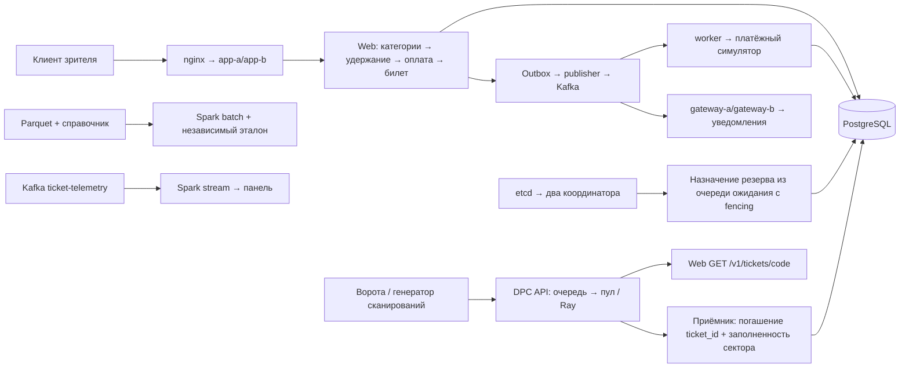

# Ментальная модель общего проекта

## Основная схема

**Web = продажа билетов. DPC = вход по билетам, аналитика и распределитель очереди ожидания.**
Общие идентификаторы по DPC C01 §6: `performance_id`, `ticket_id`.
В общей схеме `events` — программа, `screenings` — конкретное выполнение;
**`screenings.id` = `performance_id`**.
PostgreSQL и Kafka могут быть общими. Общая БД не разрешает дважды выполнять
одну операцию. Каждый переход состояния имеет одного владельца.



Схема описывает целевую модель методичек, а не готовый код.

## Владельцы изменений (DPC, стр. 22, C01 §6)

| Состояние / действие | Владелец | Условие |
|---|---|---|
| Продажа, удержания, остаток категории, выпуск билета | Только Web | Атомарный инвариант категории; один билет на hold |
| Проверка действительности билета | Web предоставляет чтение | DPC обращается к `GET /v1/tickets/{code}` как авторизованный сервис |
| Погашение билета | Только DPC | Стабильный ключ эффекта `ticket_id`; новый `scan_id` того же билета не создаёт новый эффект |
| Заполненность сектора фан-зоны | Только DPC | `inside <= capacity`; проверка и изменение в одной критической секции |
| Изъятие возвращённого места из свободной продажи | Web | Сначала создаёт резерв и передаёт его ID в DPC |
| Назначение этого резерва покупателю очереди | DPC | Своя таблица назначений; текущее зарегистрированное поколение проверяется на ресурсе |
| Выпуск билета по назначению | Web | Один раз, ключ — ID назначения |

Резерв не возвращается в свободную продажу до завершения или согласованного
отменения назначения. Лидерская lease сама по себе не защищает ресурс.
Для аналитики разрешены синтетические данные; они не подменяют операции,
которые должны пройти через Web и быть подтверждены его состоянием.

## Web C01 (стр. 20–22)

- Роли: зритель `user`, администратор площадки `staff`.
- Цикл: выбрать событие и категорию → удержать K мест на **10 минут** → оплатить → получить билет.
- Статусы hold: `held → confirmed | expired | cancelled`; `confirmed → refunded`.
- Инвариант 1: активные удержания и билеты суммарно не превышают capacity категории; `available >= 0`.
- Инвариант 2: не больше одного билета на одно удержание.
- Оплата допустима только при `held` и строго до `expires_at`.
- Деньги: целые копейки + валюта. Возврат более чем за 24 часа — 100%; ровно за 24 часа или позже — 50%, вниз до копейки (расширенные граничные проверки относятся к Д1.5).
- Время: `timestamptz` + отдельно `venue.tz`, длительность в минутах; ровно 10 минут — истечение.
- Пример гонки: **300 покупателей / 50 последних мест**, через оба экземпляра.
- Персонал закрывает продажи категории; новые удержания получают `409`.
- Симулятор только платежа: `POST /charge`, **2–8 с**, **20% предметных отказов**, **5% 503**. Он выполняет списание, Web сам выпускает билет.
- Web ЛР6: переход от количества мест категории к конкретным ряду/номеру; старому клиенту сервер сам назначает свободные места категории.
- Не требуются графическая схема зала, настоящие платежи, рекомендации. QR и интерактивный план зала — не обязательное ядро.

Предлагаемые таблицы (названия адаптируемы):

| Таблица | Поля |
|---|---|
| `venue` | id, name, city, tz |
| `event` | id, venue_id, title, starts_at, duration_min |
| `seat_category` | id, performance_id → event, name, capacity, available, price_minor, currency, sales_open |
| `hold` | id, user_id, category_id, seats, holder_name, status, version, created_at, expires_at |
| `ticket` | id, hold_id, code, status |

Маршруты карточки: `GET /v1/events`, `GET /v1/events/{id}/categories`,
`POST /v1/holds {category_id,seats}`, `GET /v1/holds`, `GET /v1/holds/{id}` (ETag),
`PATCH /v1/holds/{id}` (holder_name, If-Match), `POST /v1/holds/{id}/cancel`,
`POST /v1/categories/{id}/close`, `GET /v1/tickets/{code}`,
`POST /v1/holds/{id}/payments` (202, operation).

Domain events: `hold.created`, `payment.requested`, `payment.succeeded`,
`payment.failed`, `event.rescheduled`. Live-уведомления: билет выпущен,
платёж отклонён, до истечения удержания 2 минуты, событие перенесено.
Наличие примера маршрута в карточке не делает соответствующее расширение обязательным.

## DPC C01 (стр. 20–22)

- Платформа входа, а не сервис касовых/партнёрских продаж.
- Ресурс `sector(id, performance_id, capacity, inside)`; посетителей не больше capacity.
- Запрос `/v1/scans`: `scan_id, ticket_id, gate, sector_id, event_time`.
- Проверка билета **100–500 мс**, вне критической секции.
- Эффект: погашение билета ровно один раз по **ticket_id**. Повтор с новым scan_id возвращает то же решение.
- История Parquet: `scan_id, performance_id, gate, sector_id, event_time, accepted`.
- Справочник событий: название, площадка, хедлайнер.
- Spark batch: **проходы и медиана времени прихода по событиям и воротам**; горячий концерт **60% строк**.
- Kafka topic **`ticket-telemetry`** — принятое пользователем имя для `scans` из карточки; событие `event_id, performance_id, ticket_id, gate, sector_id, accepted, event_time`.
- Stream: **фиксированное окно 1 минута**, ключ **gate**, число **accepted=true**.
- Буфер ворот может опоздать до **10 минут**; это пример задержки, не автоматически выбранный watermark.
- Координатор: распределитель возвращённых мест очереди ожидания; защищённый эффект — назначение резерва покупателю.

Численная модель ЛР2:

```text
lambda(t) = A * t * exp(-t/tau),  t in [0,T], tau > 0
F(t) = -A*tau*(t+tau)*exp(-t/tau)
integral(0,T) = A*tau^2 - A*tau*(T+tau)*exp(-T/tau)
```

Интеграл — ожидаемое число проходов за первые T минут от открытия входа,
не динамическая цена. Произвольные границы `a,b`: эталон `F(b)-F(a)`.
Значения A/tau/T и допуски ещё предстоит выбрать и документировать.
Дополнительный метод: Monte Carlo очереди k ворот; контроль M/M/1 при постоянной
интенсивности, экспоненциальной проверке и одних воротах.
Гистограмма (Д2.5): время прихода относительно начала концерта по минутам.

Предметные маршруты: POST `/v1/scans` (202, при полной очереди 429),
GET `/v1/scans/{id}`, GET `/v1/sector/{id}`. Общие служебные маршруты — в DPC.md.

## Идентификаторы и границы гарантий

Не путать `scan_id` (запрос), `ticket_id` (эффект), `event_id` (логическое сообщение),
ID async-операции Web, Idempotency-Key HTTP и ID назначения очереди ожидания.
Ретраи одного сообщения сохраняют ID и содержимое. Две реальные разные
события одного объекта получают разные event_id.
HTTP-идемпотентность, дедупликация брокера/потребителя, погашение билета,
восстановление stream и fencing — разные гарантии с разными ключами.
Не называть доставку exactly-once без уточнения границы эффекта.

## Текущий каркас и целевая организация

На 2026-11-20: общий каркас и миграция 001 сохранены; миграция 010, DPC API
сканирования, bounded queue и защищённый sector effect реализованы. Локальный
fixture-опыт DPC ЛР1 и его результаты — `results/dpc-lr1.md`. Интеграция с Web
ticket API ожидает реализацию Web ЛР1. На 2026-11-23 DPC ЛР2 реализована
отдельно от БД; результаты и параметры модели — `results/dpc-lr2.md` и
`docs/contracts/DPC-LR2.md`. Остальные лабораторные не выполнены.
Пример одногруппников carsharing-c08 — образец организации, не требования C01.
